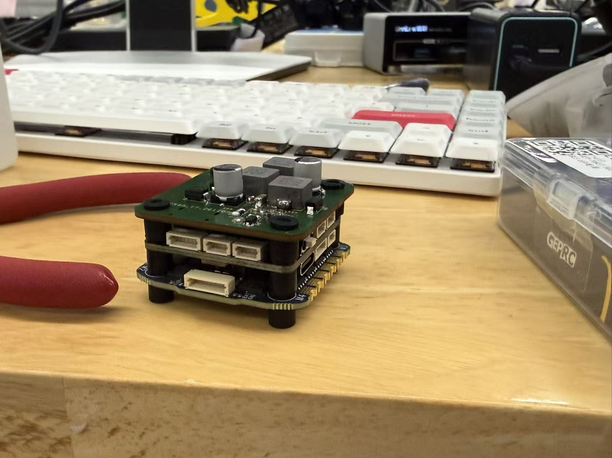
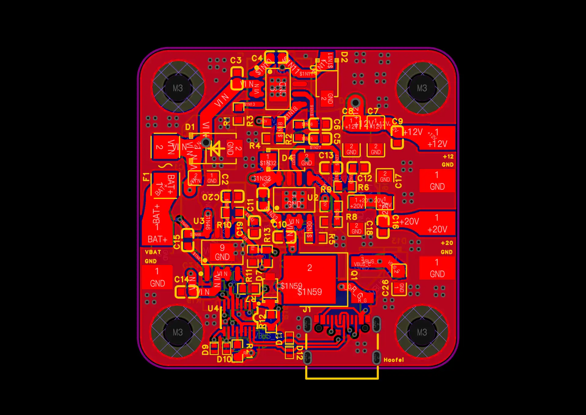
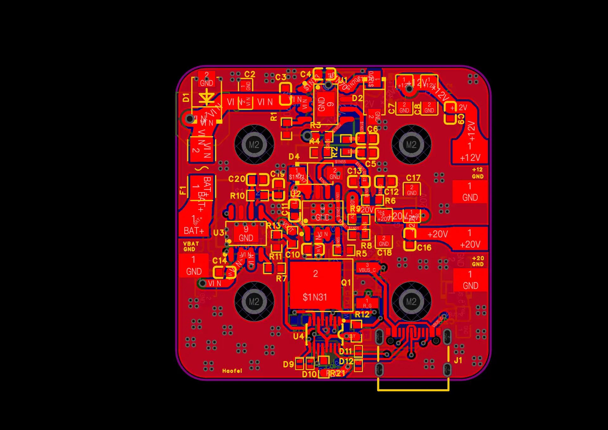
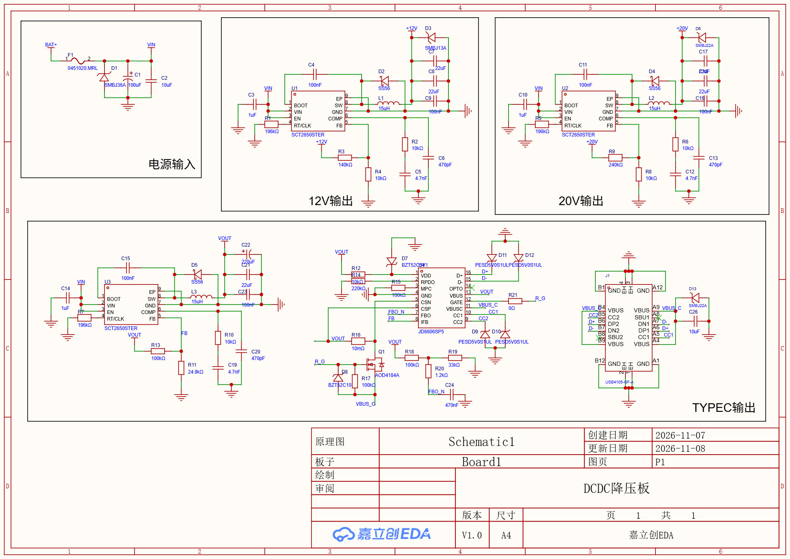
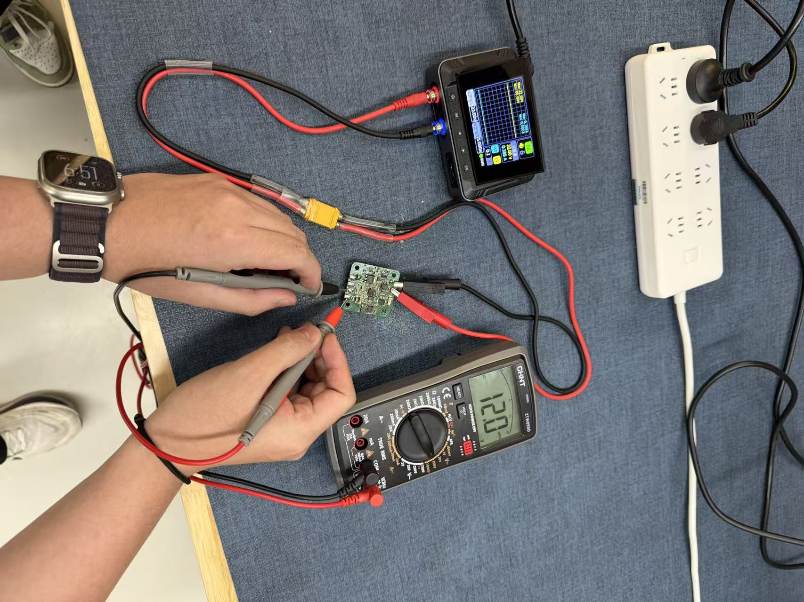
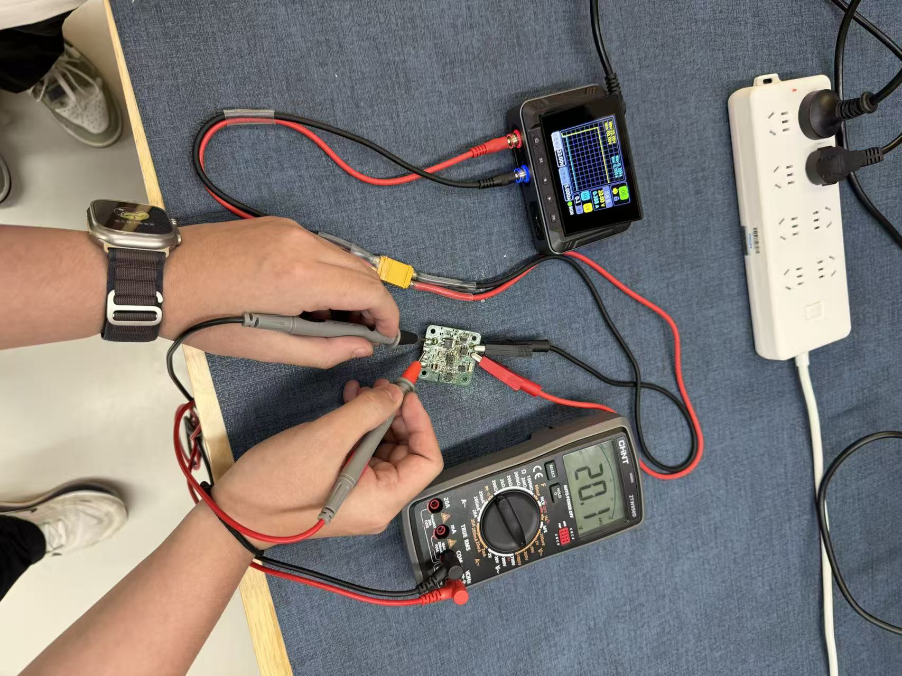

# DCDC Robot Power Board · 机器人电源板

面向配备 **MID360 雷达或同类 12V 输入设备**的机器人设计的 DC-DC 电源板，包含 **12V、20V 与 USB Type-C 输出电路**。本仓库公开嘉立创 EDA 专业版工程、PCB / 原理图预览，以及样板测试和装配实拍。

12V 支路面向雷达等设备的供电需求；具体接线、极性、启动与持续负载能力须与所用设备要求逐项核对。当前资料记录了板级设计与样板电压测试，尚未提供 MID360 或完整机器人系统的验证记录。

An open hardware DC-DC power board for robots using a MID360 lidar or similar devices with a 12V input, with 12V, 20V and USB Type-C output circuits. JLCEDA Pro source, design previews and prototype photographs are included. Wiring and load capability must be checked against the connected device; complete MID360 or robot-system validation is not documented here.

**[下载导入工程](hardware/DCDC.epro2) · [测试记录](docs/testing.md) · [文件与版本说明](docs/design.md) · [许可证](LICENSE)**

## 机械装配示例：飞塔堆叠



上图为飞塔堆叠的实际机械装配示例：DCDC 板位于堆叠顶部，使用四角支柱安装。这种装配展示了电源板的紧凑集成方式；下层板卡的设计不包含在本仓库中，机器人上的安装孔距、净空及接口匹配须按实际硬件核对。

## 电路设计

| 项目 | 工程中可确认的内容 |
| --- | --- |
| 设计工具 | 嘉立创 EDA 专业版 / JLCEDA Pro |
| 输入 | `BAT+` / `GND`，输入侧有保险丝与 TVS 电路 |
| 固定输出 | 原理图标注 `+12V`、`+20V` |
| Type-C 输出 | 独立降压支路、JD6606SP5 与 USB Type-C 接口电路 |
| 降压芯片 | U1、U2、U3：SCT2650STER |
| 其他主要器件 | U4：JD6606SP5；Q1：AOD4184A |
| 工程内容 | Schematic1 / PCB1、Schematic2 / PCB2，以及 Panel1 元数据条目 |
| 板框尺寸 | 两版均约 40 × 40 mm |
| PCB1 安装孔 | 30.5 × 30.5 mm 孔距，孔径 3.2 mm（M3） |
| PCB2 安装孔 | 20 × 20 mm 孔距，孔径 2.2 mm（M2） |

两版采用相同电路与器件配置，布局和安装孔规格不同。以上描述来自工程本身。输入工作范围、持续输出电流、总功率和 Type-C 协议档位尚未在本仓库中形成完整验证记录，不能仅凭芯片型号或照片推定整板额定性能。

### PCB 预览

以下为工程内置的二维布线预览；实物外观见上方堆叠照片和下方测试照片。

| PCB1 | PCB2 |
| --- | --- |
|  |  |

### 原理图



[查看 Schematic2 原理图](docs/images/schematic2.webp)。预览用于快速浏览，设计与生产数据请以可编辑工程为准。

## 样板测试照片

| 万用表约 12.0V | 万用表约 20.1V |
| --- | --- |
|  |  |

照片保留原始内容。测试输入电压、负载电流、温升和示波器探头设置未随照片提供，因此这两张照片仅记录拍摄时的电压读数，不能替代效率、纹波或满载测试报告。详见 [测试记录](docs/testing.md)。

## 打开与复用

1. 下载完整仓库，或下载可导入的 [`hardware/DCDC.epro2`](hardware/DCDC.epro2)。
2. 使用嘉立创 EDA **专业版**导入 `.epro2` 工程，查看两版原理图与 PCB；仓库也保留原始 [`.eprj2` 本地工程](hardware/DCDC.eprj2)。
3. 根据机器人安装空间与目标设备，核对板框、安装孔、元件高度、接口方向及供电要求，再选择所需 PCB。
4. 从选定 PCB 重新导出 BOM、Gerber 和贴片坐标，并完成设计检查后再打样。

仓库保存的是设计源文件与展示材料，未附经复核的生产包。首次上电应核对极性、短路及输出设定，并在限流电源下验证。

## 文件结构

```text
hardware/
  DCDC.epro2                 嘉立创 EDA 专业版导入工程
  DCDC.eprj2                 原始本地工程
docs/
  design.md                 工程、文件及版本说明
  testing.md                实拍测试记录与待验证项目
  images/
    flight-stack.jpg        飞塔堆叠实拍
    bench-test-12v.jpg       台架测试实拍（约 12.0V）
    bench-test-20v.jpg       台架测试实拍（约 20.1V）
    pcb1-layout.webp         PCB1 工程预览
    pcb2-layout.webp         PCB2 工程预览
    schematic1.webp         Schematic1 工程预览
    schematic2.webp         Schematic2 工程预览
LICENSE                     CERN-OHL-P-2.0 完整条款
NOTICE.md                   版权及第三方材料说明
```

## 开源许可

Copyright © 2026 Haofei Hu. 本项目中作者有权许可的设计、文档与照片采用 **CERN-OHL-P-2.0**。完整条款及第三方材料说明见 [LICENSE](LICENSE) 和 [NOTICE.md](NOTICE.md)。

欢迎通过 Issues 提交复现结果、实测数据或设计改进建议，并注明所用 PCB 版本。
