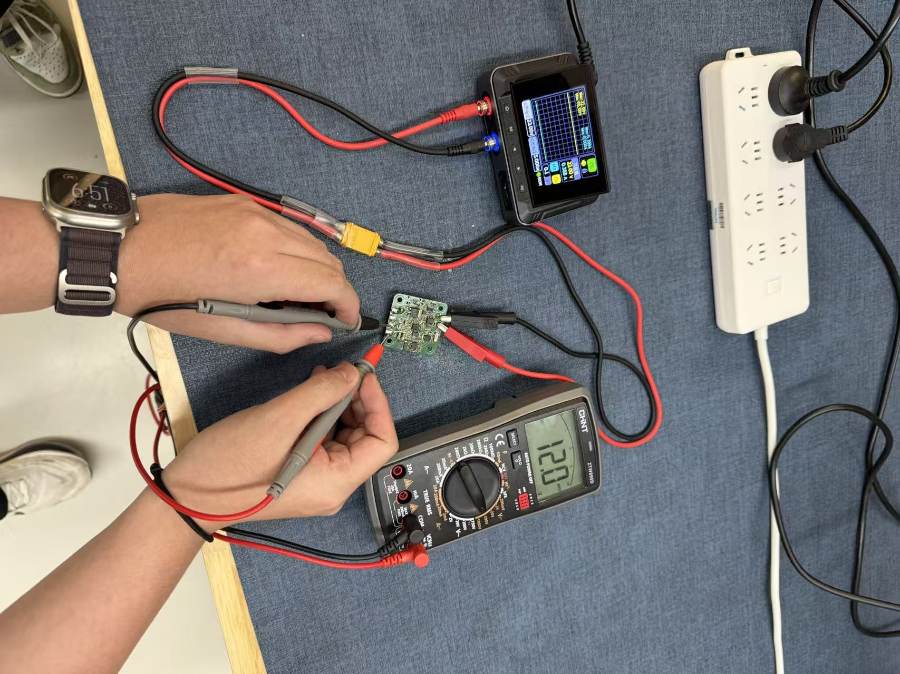
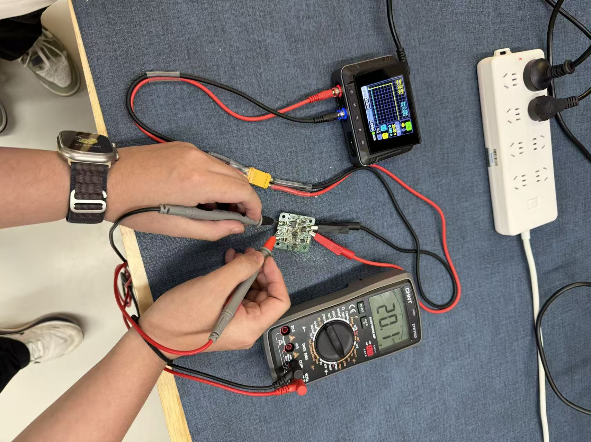

# 样板测试记录

本页整理随工程发布的两张测试照片，不补写照片中没有记录的实验条件。

## 照片 1：约 12.0V

可见内容：样板、外部供电接线、万用表及示波器。万用表读数约为 **12.0V**。

## 照片 2：约 20.1V

可见内容：同类台架接线及测试仪表。万用表读数约为 **20.1V**。

## 记录边界

| 测试条件 / 指标 | 当前记录 |
| --- | --- |
| 万用表电压读数 | 照片中约 12.0V、20.1V |
| 测试日期、PCB 版本对应关系 | 未提供 |
| 输入电压、输入电流 | 未记录 |
| 测量点标识、负载类型及负载电流 | 未记录 |
| 纹波、瞬态响应 | 未提供可复核的测量设置和波形数据 |
| 效率、温升、持续输出能力 | 未提供测试数据 |
| Type-C 协议协商及各档位带载能力 | 未提供测试数据 |

不能将画面中的示波器显示直接解释为输出纹波指标：缺少探头倍率、接地方式、耦合模式、带宽限制与测点说明。

## 后续可补充的验证

- 各输出在不同输入电压、不同负载下的电压及效率。
- 输出纹波、启动过程与负载阶跃响应，并保存测试设置和波形。
- 持续带载温升和各支路同时工作时的性能。
- Type-C 协议协商结果、线缆条件及各档位负载测试。
- 堆叠后的绝缘、安装净空和接口可达性。

欢迎提交附带 PCB 版本、仪器设置及原始记录的测试结果。
